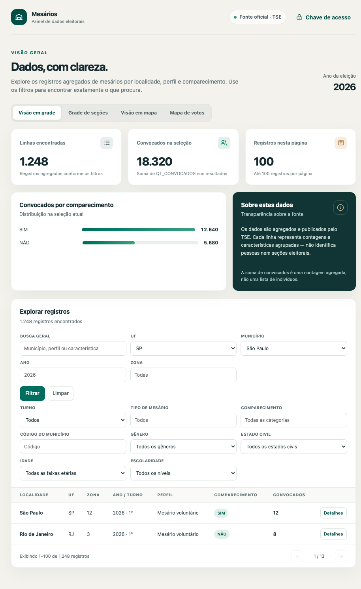
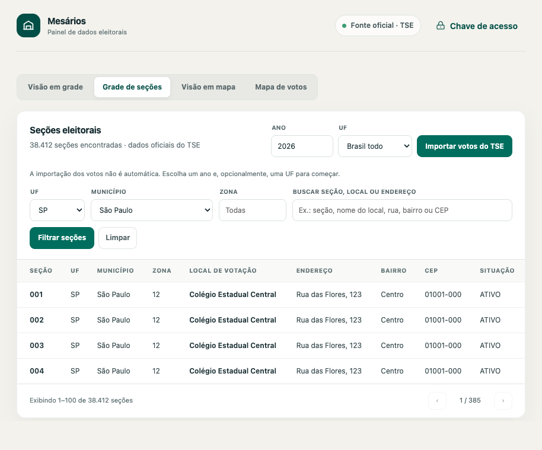
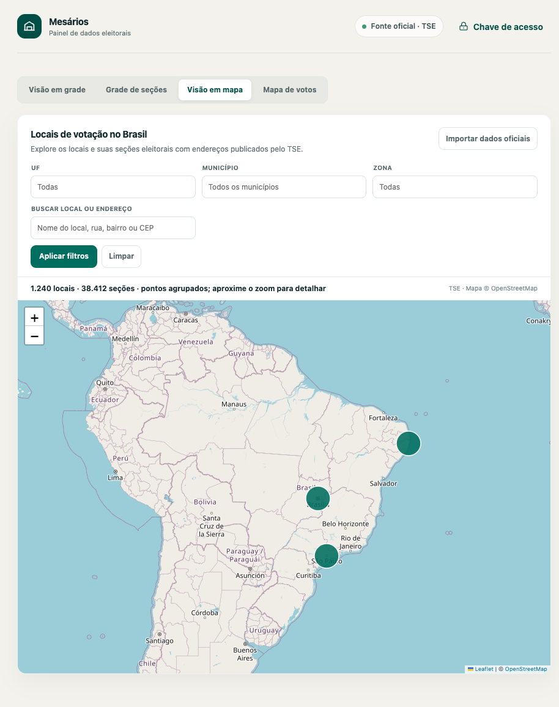
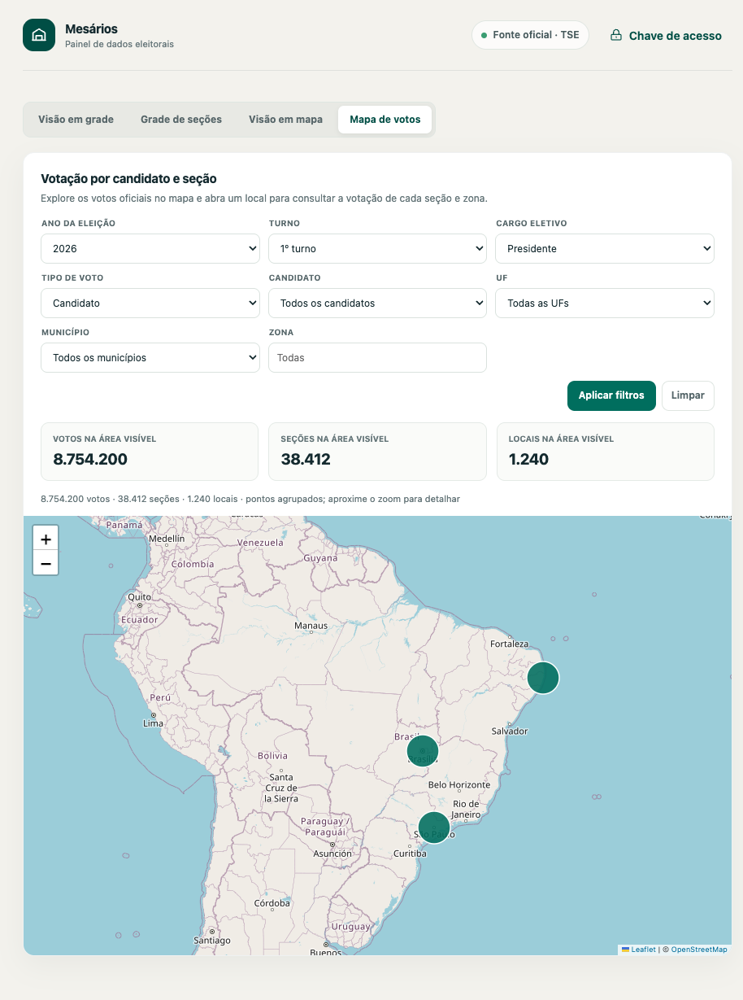

# Painel de dados eleitorais

Aplicação web em FastAPI para importar e explorar conjuntos públicos do Tribunal Superior Eleitoral (TSE). Inclui uma API protegida por chave e um dashboard servido pela própria aplicação. Os dados importados ficam em MySQL, que pode ser criado localmente em container Docker ou usado em um servidor remoto.

## O que o projeto faz

- Importa dados agregados de mesários do TSE e mostra totais e distribuições por localidade e perfil.
- Importa locais e seções eleitorais, com endereços e coordenadas quando publicados, e permite explorá-los em mapa e tabela.
- Importa resultados oficiais por seção, cargo e opção de voto. As cargas são manuais e o painel acompanha o progresso.
- Mostra votos por candidato, votos brancos, nulos e de legenda em um mapa interativo, com filtros por eleição, turno, cargo, UF, município e zona.
- Exibe detalhes dos votos por seção e, para candidatos de 2026, a foto oficial hospedada no endereço configurado em `CANDIDATE_PHOTOS_BASE_URL`.
- Registra fontes e execuções de importação para auditoria.

Os dados públicos de mesários são agregados por zona e características: não identificam pessoas nem informam comparecimento individual. A aplicação não acessa o Sistema ELO.

## Capturas de tela

As capturas abaixo ilustram as abas do painel. Os números, registros e pontos exibidos são fictícios e servem apenas para demonstrar a interface; não representam resultados oficiais.

### Visão em grade



### Grade de seções



### Visão em mapa



### Mapa de votos



## Requisitos

- **Docker Desktop** com Docker Compose (Windows ou macOS), ou Docker Engine com o plugin Compose (Linux); ou, para desenvolvimento sem Docker, **Python 3.12**.
- Docker Compose para usar o assistente ou iniciar um MySQL local em container. Se optar por banco remoto, ele deve estar acessível pela máquina da aplicação; informe host, porta, banco, usuário e senha e conceda permissões para criar e alterar tabelas.
- Acesso à internet para consultar os arquivos públicos do TSE, carregar o mapa e acessar as fotos hospedadas.

## Gerar a chave (token) de acesso

A chave de acesso do painel é configurada como `API_KEY`. Na instalação assistida, ela é gerada automaticamente e gravada no arquivo `.env`. Após a instalação, consulte esse arquivo e informe o valor da `API_KEY` quando o painel solicitar a chave.

Se estiver configurando o `.env` manualmente, gere uma chave aleatória forte com Python:

```bash
python -c "import secrets; print(secrets.token_urlsafe(32))"
```

Copie o valor gerado para `API_KEY` no `.env`, substituindo o exemplo:

```dotenv
API_KEY=cole-aqui-o-valor-gerado
```

Não reutilize o texto de exemplo nem compartilhe a chave: ela permite acessar a API e deve ser mantida em segredo, como uma senha.

## Instalação assistida

O assistente pergunta qual configuração deseja usar:

1. **MySQL local em Docker:** cria um container MySQL e um volume persistente para os dados. Não é necessário contratar ou configurar outro servidor de banco.
2. **MySQL remoto:** conecta a um servidor e banco já existentes. Peça ao administrador da hospedagem o host, a porta, o nome do banco, o usuário e a senha; confirme que o usuário pode criar e alterar tabelas e que a hospedagem libera conexões da máquina de instalação. O assistente não cria banco nem usuário no provedor remoto.

Nas duas opções, o assistente gera uma `API_KEY`, testa a conexão, aplica as migrações e inicia a aplicação.

Instale e inicie o Docker Desktop (Windows ou macOS) ou Docker Engine com Compose (Linux), instale Python 3.10 ou superior e execute:

```bash
git clone https://github.com/josedarci/mesarios.git
cd mesarios
python3 scripts/setup.py
```

No modo local, as credenciais do MySQL são geradas automaticamente e o banco é criado na primeira inicialização. Os dados ficam em um volume Docker chamado `mysql-data`, persistindo quando os containers são encerrados ou atualizados. No modo remoto, o assistente solicita os dados de conexão e oculta a senha durante a digitação. Em ambos os casos, as configurações ficam no `.env`, com permissões restritas quando o sistema operacional permite. Se `.env` já existir, o assistente para sem sobrescrevê-lo. O arquivo não deve ser compartilhado.

No Windows, use `py -3 scripts/setup.py` no PowerShell. Ao terminar, acesse <http://localhost:8000/> e informe a chave gerada, que pode ser consultada no `.env`. Se a verificação de conexão ou as migrações falharem, confira os dados do banco e os logs indicados pelo assistente. No modo local, use `docker compose -f docker-compose.yml -f docker-compose.local.yml logs -f api`; no remoto, use `docker compose logs -f api`.

## Executar com Docker

Na máquina em que o projeto será executado, clone o repositório:

```bash
git clone https://github.com/josedarci/mesarios.git
cd mesarios
cp .env.example .env
```

No Windows PowerShell, o comando para copiar o arquivo é:

```powershell
Copy-Item .env.example .env
```

Crie o `.env` a partir do exemplo e configure:

- `MYSQL_HOST`, `MYSQL_PORT`, `MYSQL_DATABASE`, `MYSQL_USER` e `MYSQL_PASSWORD` com os dados do MySQL.
- `API_KEY` com uma chave aleatória forte, que será solicitada pelo painel.
- `CANDIDATE_PHOTOS_BASE_URL` com o endereço público das fotos dos candidatos. O valor padrão aponta para `https://josedarci.com/eleicoes2026/fotos-candidatos`.

O arquivo `.env` contém credenciais e não deve ser compartilhado nem enviado ao Git. O servidor MySQL precisa aceitar conexões da máquina que executará o Docker; limite o acesso à porta do banco no firewall e conceda somente as permissões necessárias. Para preencher essa configuração e validar a conexão automaticamente, prefira o assistente descrito acima.

Inicie a aplicação:

```bash
docker compose up --build -d
```

Na primeira inicialização, o serviço aplica as migrações ao MySQL e inicia o servidor. Acesse:

- Painel: <http://localhost:8000/>
- Documentação interativa da API: <http://localhost:8000/docs>
- Verificação da conexão com o banco: <http://localhost:8000/health>

Para acompanhar os logs, use `docker compose logs -f api`. Para encerrar, use `docker compose down`. Os dados permanecem no MySQL; parar ou atualizar o container não apaga as tabelas.

## Executar localmente sem Docker

Instale Python 3.12 e garanta que o MySQL configurado esteja acessível. Na raiz do projeto:

```bash
python3.12 -m venv .venv
source .venv/bin/activate
python -m pip install -r requirements.txt
cp .env.example .env
```

No Windows PowerShell, crie e ative o ambiente virtual com:

```powershell
py -3.12 -m venv .venv
.\.venv\Scripts\Activate.ps1
python -m pip install -r requirements.txt
Copy-Item .env.example .env
```

Configure `.env` com os dados do banco e uma `API_KEY`. Aplique as migrações e inicie o servidor:

```bash
alembic upgrade head
uvicorn app.main:app --reload
```

Abra <http://localhost:8000/>. O modo `--reload` é indicado para desenvolvimento; para manter a aplicação rodando para outras pessoas, use Docker Compose ou um servidor de aplicação/serviço configurado para produção. Para executar os testes, use `pytest`.

## Instalar em outra máquina

O método disponível atualmente para instalar em um computador de usuário é executar a aplicação em container Docker; **o projeto ainda não fornece instalador nativo `.exe` ou `.dmg`**. Instale o Docker compatível com o sistema operacional, clone o repositório, configure o `.env` e inicie com `docker compose up --build -d`, conforme as instruções acima.

A instalação precisa de uma conexão com o MySQL configurado. No Compose deste projeto, o banco pode estar em um servidor remoto ou ser instalado e configurado separadamente na própria máquina. A aplicação não cria banco local automaticamente. Se vários usuários precisarem compartilhar os mesmos dados, mantenha a aplicação e o MySQL em um servidor acessível e distribua apenas o endereço do painel; não exponha diretamente a porta do banco à internet.

## Importar e consultar dados

As importações são iniciadas manualmente pelo painel e exigem uma chave `API_KEY` válida:

- Na aba **Visão em mapa**, use **Importar dados oficiais** para importar locais e seções do conjunto `eleitorado-2026`. Esses dados são armazenados em `polling_sections` e `polling_locations`.
- Na aba **Grade de seções**, use **Importar votos do TSE** para iniciar a importação de resultados. Escolha o ano e, opcionalmente, uma UF; sem UF, a operação é nacional. Uma carga concluída com sucesso fica bloqueada para evitar repetição do mesmo escopo. Cargas em andamento também não podem ser duplicadas.
- Na aba **Mapa de votos**, escolha ano, turno e cargo para filtrar candidatos ou tipos de voto e consultar os votos por local e seção. A visualização depende de resultados e dados geográficos previamente importados.
- A grade principal permite filtrar, pesquisar, paginar e consultar os dados agregados de mesários.

As tabelas `elections` e `section_votes` guardam os resultados por eleição, turno, UF, município, zona, seção, cargo e opção de voto. Cada importação mantém referências à fonte e à execução para auditoria.

As rotas que consultam dados exigem o cabeçalho `X-API-Key`. Exemplo:

```bash
curl 'http://localhost:8000/api/v1/mesarios?uf=SP&zone=12&election_year=2026' \
  -H 'X-API-Key: sua-chave'
```

Rotas principais: `GET /api/v1/mesarios/visualizacao`, `GET /api/v1/mesarios`, `GET /api/v1/indicadores/nacional`, `POST /api/v1/mapa/importacoes/tse`, `GET /api/v1/mapa/locais`, `POST /api/v1/resultados/importacoes/tse`, `GET /api/v1/resultados/importacoes/{import_id}` e `GET /api/v1/resultados/mapa`. A lista completa está em `/docs`.

## Segurança e dados

Proteja o arquivo `.env`, use uma chave de API forte e restrinja o acesso ao MySQL por firewall e permissões. A chave de API é uma proteção operacional básica; antes de disponibilizar o painel publicamente, configure também HTTPS, controles de acesso e monitoramento adequados ao ambiente.

O projeto importa arquivos públicos do TSE. Dados de mesários são estatísticos e agregados; a aplicação não disponibiliza nomes de mesários nem permite inferir se uma pessoa específica compareceu.
